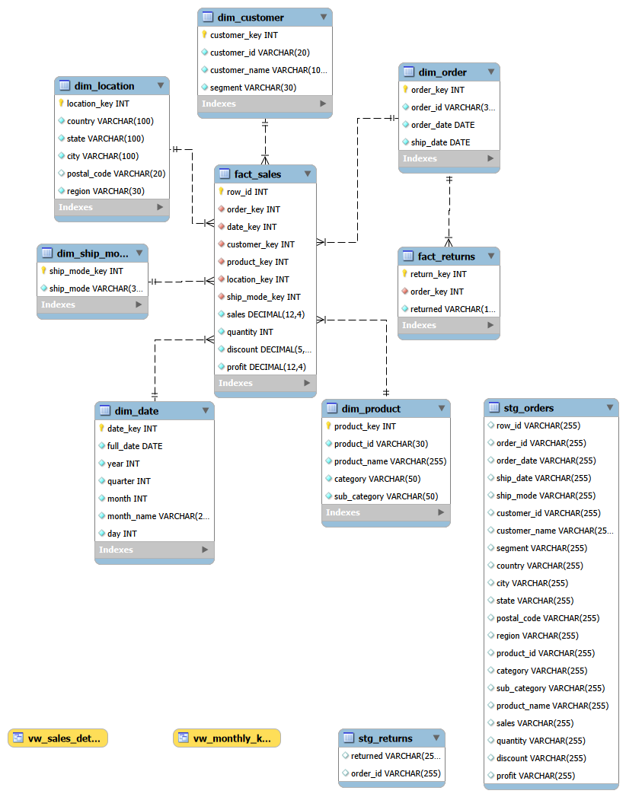

# MySQL Superstore Data Warehouse & Business Analytics

Data warehouse project.

The project transforms the Sample Superstore Excel dataset into a structured analytical database using **MySQL 8.0**, applying Star Schema dimensional modeling, SQL-based data transformation, analytical queries, and performance evaluation.

## Project Overview

The original dataset contains retail sales and returns information. The goal was to design and implement a relational data warehouse that supports business analysis and KPI reporting.

The project covers the process from raw data staging to dimensional modeling, data loading, validation, and analytical reporting.

## Dataset

**Source:** Sample Superstore 2019 Excel workbook

| Sheet   | Records | Usage                             |
| ------- | ------: | --------------------------------- |
| Orders  |   9,994 | Used for sales analysis           |
| Returns |     800 | Used for return analysis          |
| People  |       4 | Not included in the project model |

The People sheet was outside the implemented scope.

## Database Design

The database, `superstore_dw`, follows a **Star Schema** with 8 warehouse tables.

### Fact Tables

| Table          | Records | Grain / Description              |
| -------------- | ------: | -------------------------------- |
| `fact_sales`   |   9,994 | One product line within an order |
| `fact_returns` |     296 | One returned order               |

### Dimension Tables

| Table           | Records | Description                           |
| --------------- | ------: | ------------------------------------- |
| `dim_customer`  |     793 | Customer details and segments         |
| `dim_product`   |   1,894 | Product details and categories        |
| `dim_date`      |   1,461 | Continuous calendar from 2016 to 2019 |
| `dim_location`  |     632 | Geographic information                |
| `dim_ship_mode` |       4 | Shipping methods                      |
| `dim_order`     |   5,009 | Order-level information               |

The model uses surrogate keys for dimension tables and foreign key relationships to connect facts with their related dimensions.

### Entity Relationship Diagram

## Data Preparation & ETL

The data pipeline was implemented using SQL, following these stages:

1. **Source Data Preparation:** Orders and Returns sheets were converted into CSV files for loading.
2. **Staging Layer:** Created `stg_orders` and `stg_returns` tables to store raw values as text.
3. **Data Transformation:** Used SQL `INSERT ... SELECT` statements to populate dimension and fact tables from staging.
4. **Dimension Loading:** Used `SELECT DISTINCT` to populate descriptive tables and generated a continuous date dimension using a recursive CTE.
5. **Fact Loading:** Joined staging records with dimensions to retrieve surrogate keys and load sales and returns data.
6. **Data Validation:** Checked record counts, key uniqueness, foreign key integrity, orphan records, date consistency, and aggregate totals.

## Data Quality Decisions

Several source-data issues were identified and handled during implementation:

- **Duplicate return records:** The 800 source rows contained 296 distinct Order IDs. One record per returned order was retained in `fact_returns`.
- **Product identifier inconsistencies:** 32 Product IDs were associated with two different product names. The product dimension was designed using a composite uniqueness rule on `(product_id, product_name)` to preserve both original product records.
- **Missing postal codes:** 11 records had blank postal codes, which were stored as `NULL` rather than replaced with invented values.
- **Postal code formatting:** 438 postal codes contained four digits because leading zeros were missing in the source. The original values were preserved and documented.
- **Data type conversion:** Dates and numeric measures were converted from staging text using SQL functions such as `STR_TO_DATE` and `CAST`.
- **Numeric precision:** Sales and profit measures were stored using `DECIMAL(12,4)` to handle floating-point precision issues.

## SQL Analysis

Developed **16 analytical SQL queries** covering the following areas:

### 1. Sales Performance

- Overall sales and profit KPIs.
- Yearly and monthly sales trends.
- Sales performance by region.
- Year-over-year sales growth.

### 2. Profitability Analysis

- Profitability by product sub-category.
- Discount band analysis using `CASE`.
- Identification of loss-making sub-categories using `HAVING`.
- Top 10 products by sales.

### 3. Customer Analysis

- Top customers by sales.
- Customer segmentation and value tiers using CTEs.
- Customers generating sales above the average.
- Order-frequency classification.

### 4. Returns Analysis

- Return rates by region.
- Identification of customers with the highest number of returned orders.
- Use of `LEFT JOIN` to include regions with no matching return records.

### SQL Concepts Applied

- INNER JOIN and LEFT JOIN
- GROUP BY and HAVING
- Subqueries and IN
- Common Table Expressions (CTEs)
- CASE statements
- Aggregate functions
- Views
- Stored Procedures

## Views & Stored Procedure

**Views:**

- `vw_monthly_kpis` – Monthly sales and profitability KPIs.
- `vw_sales_detail` – Detailed sales data with related dimension information.

**Stored Procedure:**

- `sp_kpi_summary(p_year, p_region)` – Returns KPI summaries filtered by year and region. Passing `NULL` allows the corresponding filter to include all values.

## Query Performance Evaluation

Four indexes were added to support query execution.

Query execution plans were compared before and after indexing using `EXPLAIN`.

The comparison showed changes such as:

- Full table scans on dimension tables becoming index lookups.
- A temporary table no longer being used in one execution plan.
- A covering index being used in one query.

Since the dataset contains approximately 10,000 sales records, runtime improvements were small. The main objective was to understand indexing and evaluate execution plans rather than claim a significant performance increase.

## Key Business Findings

The analytical results were validated against the source dataset.

| KPI             |        Result |
| --------------- | ------------: |
| Total Sales     | $2,297,200.86 |
| Total Profit    |   $286,397.02 |
| Profit Margin   |        12.47% |
| Total Orders    |         5,009 |
| Total Customers |           793 |

### Additional Insights

- Sales declined by **2.83% in 2017**, then increased by **29.47% in 2018** and **20.36% in 2019**.
- Discount bands above 20% were associated with negative profit margins in the analyzed dataset.
- Tables, Bookcases, and Supplies were loss-making sub-categories.
- The highest-sales customer generated negative total profit.
- 117 high-value customers accounted for 39.7% of total sales.
- The West region had an order return rate of 11.73%, compared with approximately 3% in the other regions.

## Tools & Technologies

- MySQL 8.0
- MySQL Workbench
- SQL
- Python (used for source data preparation during development)
- Star Schema dimensional modeling

## Repository Contents

| File                            | Description                                                    |
| ------------------------------- | -------------------------------------------------------------- |
| `Superstore.sql`                | SQL database export containing the database structure and data |
| `Superstore_Data_Warehouse.mwb` | MySQL Workbench data model                                     |
| `superstore-erd.png`            | Entity Relationship Diagram                                    |
| `README.md`                     | Project documentation                                          |

## Development & Learning Approach

My contributions included making implementation and data-handling decisions, executing SQL statements in MySQL Workbench, reviewing and validating query results, troubleshooting import and environment issues, modifying the product dimension constraint, and preparing the final scripts and GitHub repository.
This project was completed as a hands-on learning exercise. AI assistance was used to generate and explain some SQL codes.

The project helped strengthen my practical understanding of relational database design, dimensional modeling, SQL transformations, analytical querying, and query execution plans.

---

**Project:** Advanced SQL Data Warehouse & Business Analytics
**Database:** `superstore_dw`
**DBMS:** MySQL 8.0
**Program:** Digital Egypt Pioneers Initiative (DEPI)
